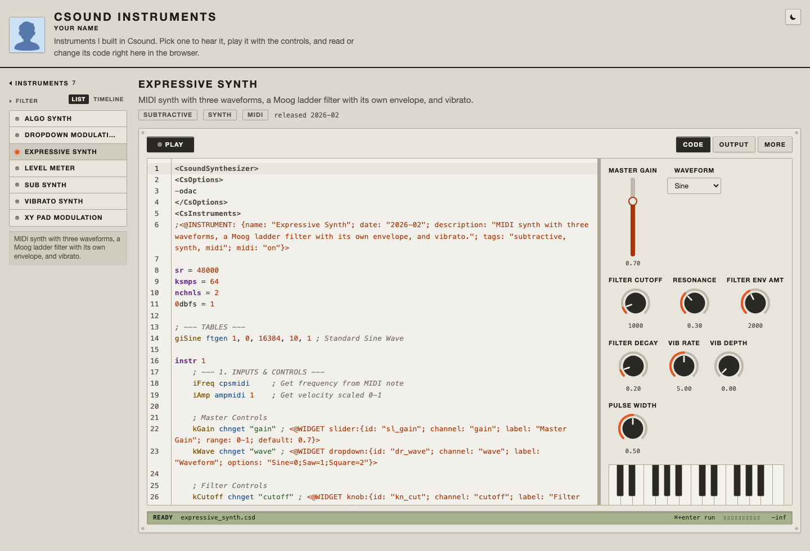
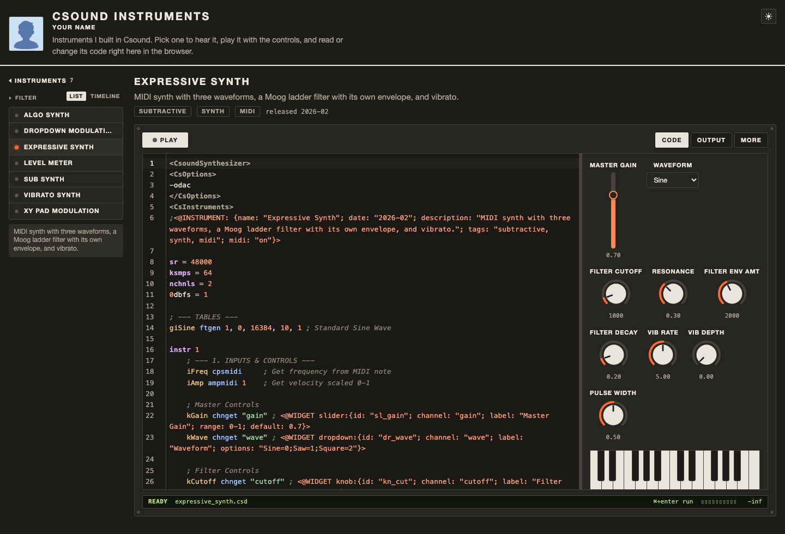
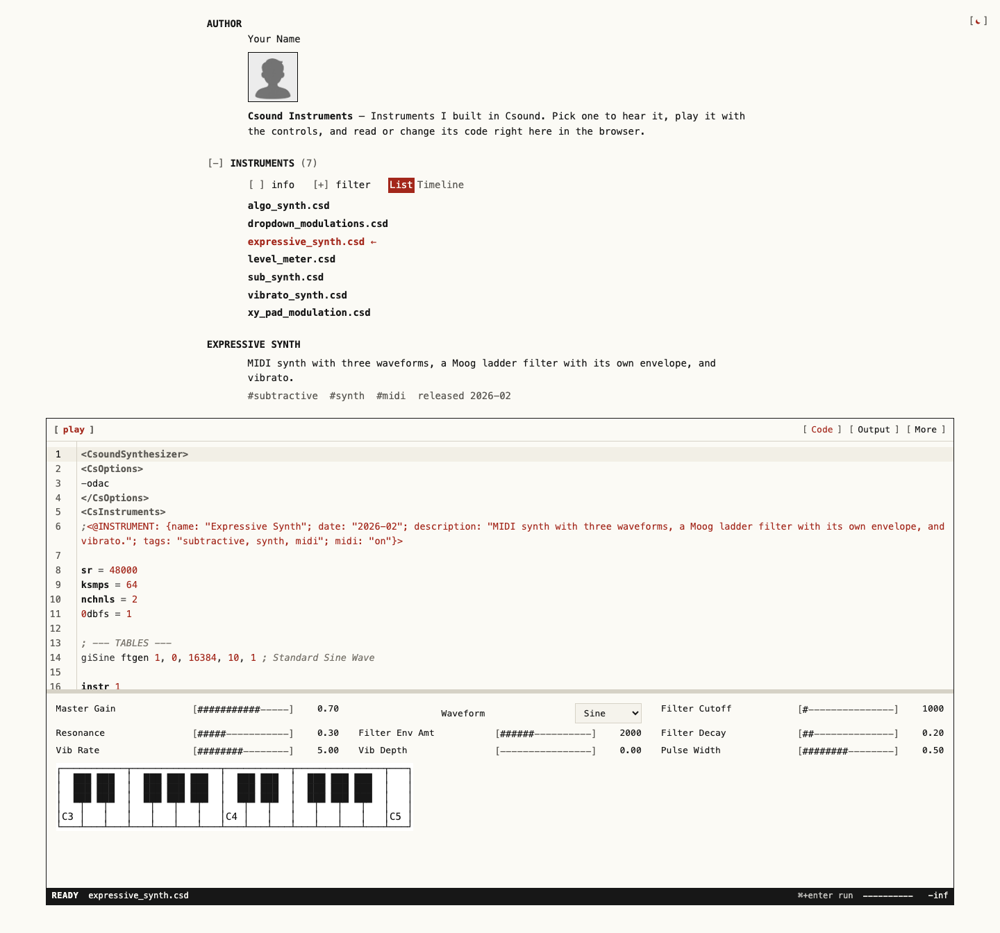
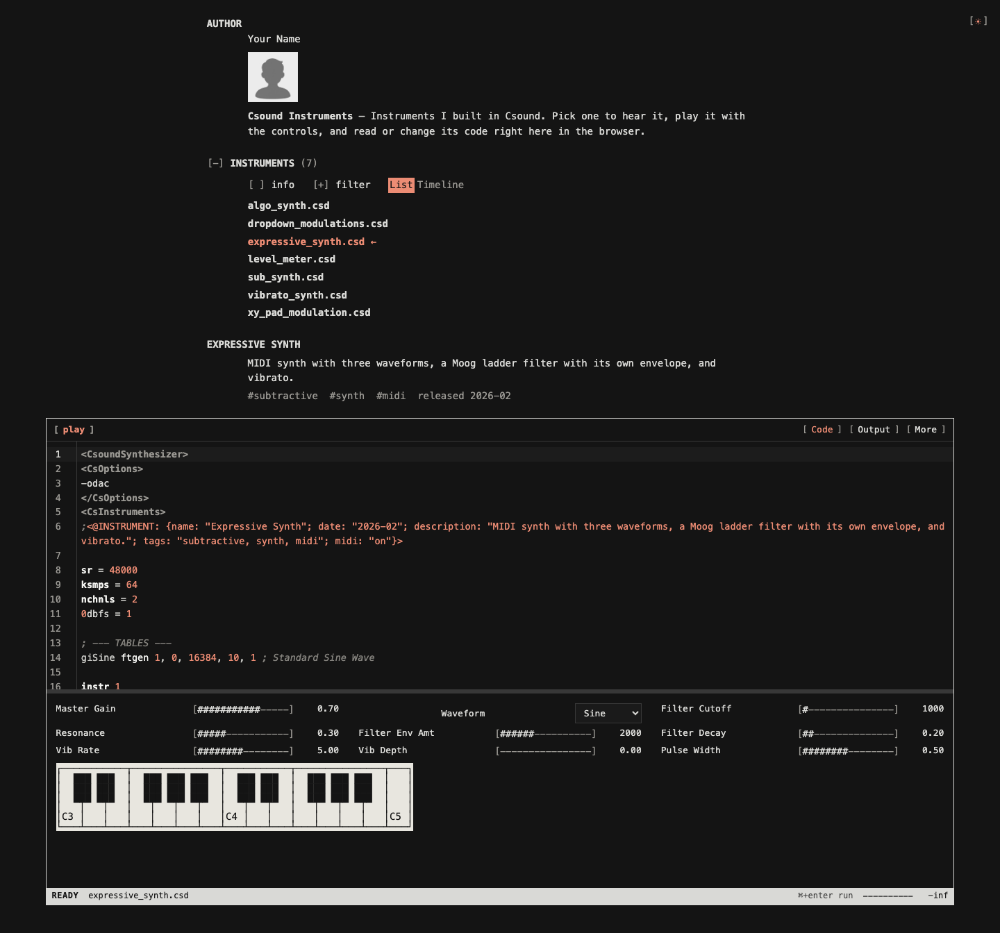

# personal csound portfolio

A website template for publishing your Csound instruments. Visitors pick an instrument, hear it straight away, play it with knobs, sliders and a keyboard, and can read and edit the code. Nothing is installed: Csound 7 runs in the browser (WebAssembly), and the site is static, so GitHub Pages or GitLab Pages host it for free.

Adding an instrument means adding a `.csd` file and pushing.

**Live demo:** [ervolb.github.io/csound-portfolio](https://ervolb.github.io/csound-portfolio/)

<table>
  <tr><th colspan="2"><code>panel</code> layout (light, dark)</th></tr>
  <tr>
    <td></td>
    <td></td>
  </tr>
  <tr><th colspan="2"><code>manpage</code> layout (light, dark)</th></tr>
  <tr>
    <td></td>
    <td></td>
  </tr>
</table>

## Any Csound code runs

The site plays plain Csound. Any CSD that runs in Csound runs here, within [what the browser allows](#what-works-in-the-browser). You don't have to change your code for the site:

- **A CSD without `chnget` or `chnset` just plays.** Visitors press Play, hear it, and can read and edit the code.
- **Widgets are optional.** They give visitors a way to interact with your code, for example a knob for a value your instrument reads with `chnget`, or a meter for a value it writes with `chnset`. Add them only where your instrument has something to control or show.
- **`@INSTRUMENT` is optional too.** It's metadata for the portfolio page: the name, description, tags and date shown with the instrument. Csound never sees it. (One field affects playback: `midi` can override whether the player sends MIDI to the instrument.)

`@WIDGET` and `@INSTRUMENT` are comments, so the same CSD still runs unchanged in any other Csound host.

## Quick start (GitHub)

1. Click **Use this template → Create a new repository**.
2. In the new repository: **Settings → Pages → Build and deployment → Source: GitHub Actions**.
3. Edit `portfolio.json` (your name, a short bio, links), replace `profile.png` with your photo, and commit.
4. The **Deploy to GitHub Pages** workflow builds and publishes the site to `https://<you>.github.io/<repository>/`.

On GitLab, the included `.gitlab-ci.yml` publishes to GitLab Pages from the default branch.

## Add an instrument

Create a folder in `instruments/` with your CSD inside:

```
instruments/
  fm-bells/
    fm-bells.csd
    preview.png      (optional card image: preview.png / .jpg / .jpeg / .webp / .svg)
```

A single file such as `instruments/fm-bells.csd` works too. Push, and the instrument appears on the site. The folder or file name becomes the link: `…/#/fm-bells`.

Before publishing, the workflow compiles and runs every instrument with the same Csound build the site uses. A broken CSD stops the deploy and the log names the file and line.

### Describe it: `@INSTRUMENT`

One comment line tells the portfolio page how to present the instrument: its name, a description, tags and a release date. It's metadata for the site and doesn't change your Csound code (only `midi` affects playback, see below). It is optional: without it the title comes from the file name.

```csound
;<@INSTRUMENT: {name: "FM Bells"; date: "2026-03-14"; description: "Two-operator FM bell with velocity-sensitive brightness."; tags: "fm, bells, mallet"}>
```

| Field | Notes |
|---|---|
| `name` | Title on the card and above the player. |
| `description` | One line of text. |
| `tags` | In quotes, separated by commas. Tags become filter buttons. |
| `date` | Release date: `"2026-03-14"`, `"2026-03"` or `"2026"`. Shown with the instrument; once any instrument has one, visitors can switch the list to a **timeline** grouped by year. |
| `author`, `license` | Stored in the generated `instruments.json` for your own page code; the built-in layouts don't show them. `vendor` works as an alias for `author`. |
| `midi` | `"on"` or `"off"`, to override MIDI detection (see below). |
| `order` | Number; lower numbers are listed first. Otherwise instruments are sorted by name. |
| `draft` | `true` hides the instrument from the site. |
| `type` | `synth` (default) or `effect`. Effects that process audio input are not supported yet. |

### Add controls: `@WIDGET`

Widgets put controls next to the code, so visitors can change what your instrument reads (`chnget`) and see what it writes (`chnset`). A widget is a comment on the line that reads or writes the channel. Csound ignores comments, so the same file still runs in any other Csound host.

```csound
kCutoff chnget "cutoff"          ; <@WIDGET knob:{label: "Cutoff"; range: 20-12000; default: 2000; scale: "logarithmic"}>
kWave   = chnget:k("wave")       ; <@WIDGET dropdown:{label: "Wave"; options: "Saw=0; Square=1; Pulse=2"}>
chnset(kRms, "level")            ; <@WIDGET meter:{label: "Level"; range: 0-1}>
chnset(kRms, "level_text")       ; <@WIDGET label:{id: "level_text"; text: "RMS: {value}"; decimals: 3}>
; <@WIDGET midi_keyboard:{start_note: 48; end_note: 72}>
```

The channel is taken from the `chnget` / `chnset` on the same line (classic or functional syntax), or set with `channel: "name"`.

| Widget | What it does | Useful properties |
|---|---|---|
| `knob` | Rotary control | `range: 0-1`, `default`, `step`, `scale: "logarithmic"`, `label` |
| `slider` | Fader | as knob, plus `orientation: "horizontal"` |
| `button` | 1 while pressed, 0 when released | `label`, `mode: "toggle"` for an on/off button |
| `checkbox`, `toggle` | On/off (0/1) as a checkbox or a switch | `label`, `default` |
| `dropdown` | Numbered choices | `options: "Sine=0; Saw=1; Square=2"`, `default` |
| `xypad` | Two values at once | `channel_x`, `channel_y`, `range_x: 0-1`, `range_y: 0-1` |
| `meter` | Shows a channel Csound writes with `chnset` | `range` |
| `midi_keyboard` | On-screen piano | `start_note`, `end_note`, `midi_channel` |
| `label` | Text. On a `chnset` line (or with `channel`), it shows the value Csound writes, about 10 times a second | `text`; with a channel, `{value}` in `text` marks where the number goes, and `decimals` sets the digits after the point |

More details:
- Visitors can double-click a knob's or slider's value, or press Enter on the knob or slider, to type an exact number.
- `group: "Filter"` puts widgets into a titled section.
- `id` is optional. Two lines with the same `id` describe one widget.
- `width` / `height` are size hints. Positions (`x`, `y`) are ignored, because the board arranges controls automatically and visitors can move it next to or below the code.

### MIDI

Visitors can play MIDI instruments with the on-screen keyboard, the computer keyboard (A W S E D F T G Y H U J K; Z/X change octave; works while the player has focus, which it gets when you pick an instrument), or a MIDI device (Chrome, Edge and Firefox). Escape stops the sound (while a value is being typed, it cancels the typing instead).

MIDI input is switched on only for instruments that use it: the CSD contains `massign` or a MIDI opcode such as `notnum`, `cpsmidi` or `veloc`, or it has a `midi_keyboard` widget. This matters because Csound sends MIDI channel *N* to `instr N` by default, so MIDI would otherwise start extra copies of, for example, a sequencer in `instr 1`. Override it with `midi: "on"` or `"off"` in `@INSTRUMENT`. MIDI instruments without a keyboard widget get an on-screen keyboard automatically.

### What works in the browser

- **Options:** the player decides how Csound runs, so most of a CSD's `<CsOptions>` are ignored (the console lists them). Kept: message level (`-m…`), macros (`--omacro:`, `--smacro:`), `-+max_str_len`, `--sample-accurate`, `--keep-sorted-score` and `-+skip_seconds`.
- **Sample rate:** the visitor's sound card rate is forced (usually 44.1 or 48 kHz). Pitch stays right because `sr` is overridden, not resampled.
- **Level:** output is scaled by your `0dbfs` (Csound 7's default is 32768). A limiter protects ears and speakers from runaway instruments.
- **Not yet supported:** loading files (samples, SoundFonts, `#include`), audio input for effects, the `system` opcode, and plugin opcodes.

## Make it yours

### Your name, photo and text

Everything about you is in `portfolio.json`:

```json
{
  "title": "Csound Instruments",
  "author": "Jane Doe",
  "avatar": "profile.png",
  "bio": "Instruments I built in Csound. …",
  "links": [{ "label": "GitHub", "url": "https://github.com/jane" }]
}
```

- `title` is the site's name (and the browser tab's).
- `author` is your name, shown next to your photo.
- `bio` is one or two sentences under it.
- `links` are optional; with an empty list (`[]`) none are shown.

**Your photo:** the template comes with a placeholder, `profile.png`. The easiest way is to replace that file with your own photo under the same name. To use another file name or format, put the file in the repository and point `avatar` at it, e.g. `"avatar": "me.jpg"` or `"avatar": "images/me.jpg"`. `avatar` can also be the `https://` address of a photo elsewhere.

- Use a square image. It is shown at about 70 × 70 pixels, so 256 × 256 is plenty and keeps the page fast.
- The build copies the file into the site for you.
- Without `avatar`, or if the file can't be loaded, the initials of `author` stand in.

### Layout

`portfolio.json → layout` picks the design:
- `panel` (default): a 1970s lab front panel, with graphic knobs and an LCD status line;
- `manpage`: the site as a Unix manual page, with text controls.

To compare them, run `npm run dev` (or open the built site with `?layouts` in the URL). A switcher appears in the bottom-right corner (Alt+1/2; Alt+0 hides it). `?layout=manpage` opens one layout directly. Visitors switch between light and dark with the sun/moon icon in the top-right corner. Until they click it, the site follows their system setting.

**Make your own layout:** a layout is one CSS file plus one line in a table. [docs/custom-layouts.md](docs/custom-layouts.md) compares the two built-in layouts and walks through building a third.

### More settings

- **Player defaults:** `portfolio.json → player.board` is `right`, `bottom` or `hidden`; `player.editor` is `open`, `collapsed` or `hidden`. A layout can set its own board position.
- **Page structure:** `index.html`, `site/style.css` and `site/main.ts` are plain HTML, CSS and TypeScript. Change them freely.
- **The player on other pages:** the player is one element, `<csound-player src="…">`, with attributes, methods and events for your own pages. See [docs/player.md](docs/player.md).

## Work on it locally

You need [Node.js](https://nodejs.org/) 20.19 or newer.

```sh
npm install
npm run dev                 # site at http://localhost:5173 (reloads when instruments change)
npm run check:instruments   # compile and run every instrument with Csound
npm run build               # the static site in dist/
npm run check               # what the deploy runs: instruments, types, tests
npm run test:e2e            # browser tests (Playwright; run `npx playwright install chromium` once)
```

`play.html` plays any CSD from a link: `…/play.html?src=https://github.com/user/repo/blob/main/synth.csd`. GitHub and GitLab page links are converted to raw-file links. The CSD runs in the visitor's browser, so open only links you trust.

## Csound version and loading

- **Version:** pinned in `player/engine/csoundRelease.json` (currently the official `@csound/wasm-bin` 7.0.0).
- **Download:** the 3.3 MB (compressed) `csound.wasm` downloads from unpkg.com after the page has loaded, while the visitor is still reading. The browser caches it for a year, and switching instruments never downloads it again.
- **Always official:** the site always uses this official build; nothing to configure.

More about loading, the engine, and what the browser changes about a CSD: [docs/how-it-works.md](docs/how-it-works.md).

## Get updates

If you created your site from this template, pull improvements from the original repository:

```sh
git remote add upstream https://github.com/ervoLB/csound-portfolio.git
git pull upstream main
```

The player lives in `player/` and the page design in `site/`, so updates rarely touch the files you changed.

## Documentation

- [docs/custom-layouts.md](docs/custom-layouts.md): make your own layout, with the two built-in ones as examples.
- [docs/player.md](docs/player.md): the `<csound-player>` element: attributes, methods, events.
- [docs/how-it-works.md](docs/how-it-works.md): the build, loading Csound, what the browser changes about a CSD, MIDI detection.

## License

The project is MIT licensed (`LICENSE`). Csound itself is LGPL-2.1 and is not part of this repository (`THIRD_PARTY_NOTICES.md`).
